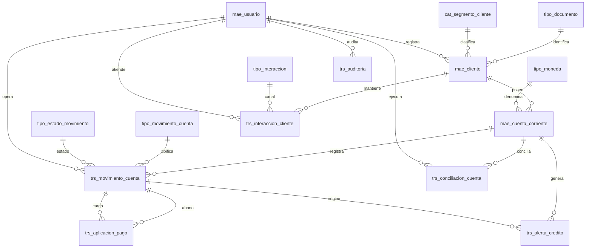

# Diccionario de Datos y Diagrama ER — CRM de Cuentas Corrientes (T3)

## 1. Diagrama Entidad-Relación (15 Tablas)

---

## 2. Tablas de Catálogo (6)

| Tabla | Descripción | Clave Primaria | Campos Principales |
| :--- | :--- | :--- | :--- |
| `tipo_documento` | Documentos de identidad | `id_tipo_documento` | `codigo` (UNIQUE), `nombre`, `longitud_exacta`, `activo` |
| `tipo_moneda` | Monedas de cuenta | `id_tipo_moneda` | `codigo` (UNIQUE), `nombre`, `simbolo`, `activo` |
| `cat_segmento_cliente` | Segmentación comercial | `id_segmento` | `codigo` (UNIQUE), `nombre`, `linea_credito_sugerida`, `dias_plazo_defecto`, `activo` |
| `tipo_movimiento_cuenta` | Tipos de cargo/abono | `id_tipo_movimiento` | `codigo` (UNIQUE), `nombre`, `naturaleza` (`C`/`A`), `requiere_vencimiento`, `activo` |
| `tipo_interaccion` | Canales de contacto | `id_tipo_interaccion` | `codigo` (UNIQUE), `nombre`, `activo` |
| `tipo_estado_movimiento` | Estados de movimiento | `id_estado_movimiento` | `codigo` (UNIQUE), `nombre`, `es_final`, `activo` |

---

## 3. Tablas Maestras (3)

### `mae_usuario`
- **PK:** `id_usuario`
- **Campos:** `nombre_completo`, `email` (UNIQUE), `password_hash`, `rol` (`ADMIN`, `ANALISTA`, `CONSULTA`), `activo`, `fecha_creacion`, `fecha_actualizacion`.

### `mae_cliente`
- **PK:** `id_cliente`
- **FK:** `id_tipo_documento` -> `tipo_documento`, `id_segmento` -> `cat_segmento_cliente`, `id_usuario_registro` -> `mae_usuario`.
- **Campos:** `tipo_persona` (`NATURAL` | `JURIDICA`), `numero_documento`, `nombre_completo` (obligatorio si `NATURAL`), `razon_social` (obligatorio si `JURIDICA`), `nombre_comercial`, `email`, `telefono`, `direccion`, `estado` (`ACTIVO`, `BLOQUEADO`, `INACTIVO`), `fecha_registro`, `fecha_actualizacion`.
- **Restricciones:** `UNIQUE(id_tipo_documento, numero_documento)`, `CHECK chk_mae_cliente_tipo_persona`.

### `mae_cuenta_corriente`
- **PK:** `id_cuenta`
- **FK:** `id_cliente` -> `mae_cliente`, `id_tipo_moneda` -> `tipo_moneda`.
- **Campos:** `numero_cuenta` (UNIQUE), `linea_credito` (`>= 0`), `estado` (`ACTIVA`, `SUSPENDIDA`, `CERRADA`), `fecha_apertura`, `fecha_actualizacion`.
- **Restricciones:** `UNIQUE(id_cliente, id_tipo_moneda)`. *El saldo no se almacena aquí; se calcula mediante `vw_cuenta_saldo`.*

---

## 4. Tablas Transaccionales (6)

### `trs_movimiento_cuenta`
- **PK:** `id_movimiento`
- **FK:** `id_cuenta` -> `mae_cuenta_corriente`, `id_tipo_movimiento` -> `tipo_movimiento_cuenta`, `id_estado_movimiento` -> `tipo_estado_movimiento`, `id_usuario_registro` -> `mae_usuario`.
- **Campos:** `numero_documento_ref`, `fecha_movimiento`, `fecha_vencimiento`, `monto` (`> 0`), `glosa`, `fecha_registro`.
- *El saldo pendiente y acumulado se calculan mediante `vw_movimiento_saldo` y funciones de ventana.*

### `trs_aplicacion_pago`
- **PK:** `id_aplicacion`
- **FK:** `id_movimiento_abono` -> `trs_movimiento_cuenta`, `id_movimiento_cargo` -> `trs_movimiento_cuenta`, `id_usuario_registro` -> `mae_usuario`.
- **Campos:** `monto_aplicado` (`> 0`), `fecha_aplicacion`.
- **Restricciones:** `id_movimiento_abono <> id_movimiento_cargo`, `UNIQUE(id_movimiento_abono, id_movimiento_cargo)`. Validación transaccional `FOR UPDATE` en backend.

### `trs_alerta_credito`
- **PK:** `id_alerta`
- **FK:** `id_cuenta` -> `mae_cuenta_corriente`, `id_movimiento_origen` -> `trs_movimiento_cuenta`, `id_usuario_resolucion` -> `mae_usuario`.
- **Campos:** `tipo_alerta` (`EXCESO_LINEA`, `PROXIMO_LIMITE` al 85%), `linea_credito_momento`, `saldo_momento`, `monto_excedido`, `mensaje`, `estado` (`ACTIVA`, `REVISADA`, `RESUELTA`), `fecha_generacion`, `fecha_resolucion`.
- **Índice único parcial:** `uq_trs_alerta_activa_unica` en `(id_cuenta, tipo_alerta) WHERE estado = 'ACTIVA'`.

### `trs_interaccion_cliente`
- **PK:** `id_interaccion`
- **FK:** `id_cliente` -> `mae_cliente`, `id_tipo_interaccion` -> `tipo_interaccion`, `id_usuario` -> `mae_usuario`, `id_gestion` -> `trs_gestion_cobranza` (opcional, permite vincular interacciones al caso de cobranza).
- **Campos:** `fecha_interaccion`, `asunto`, `detalle`, `resultado`, `fecha_proximo_seguimiento`.

### `trs_gestion_cobranza`
- **PK:** `id_gestion`
- **FK:** `id_cuenta` -> `mae_cuenta_corriente`, `id_usuario_responsable` -> `mae_usuario`, `id_usuario_registro` -> `mae_usuario`.
- **Campos:** `motivo`, `estado` (`ABIERTA` | `CERRADA`), `observaciones_cierre`, `fecha_apertura`, `fecha_cierre`.
- **Flujo y reglas:** Representa un caso de seguimiento de deuda sobre una cuenta corriente. Abrir o cerrar una gestión no altera el saldo de la cuenta. Una gestión puede agrupar múltiples interacciones y múltiples compromisos de pago.

### `trs_compromiso_pago`
- **PK:** `id_compromiso`
- **FK:** `id_gestion` -> `trs_gestion_cobranza`, `id_movimiento_abono` -> `trs_movimiento_cuenta` (`UNIQUE`, opcional), `id_usuario_registro` -> `mae_usuario`.
- **Campos:** `fecha_pactada`, `monto_comprometido` (`> 0`), `estado` (`PENDIENTE` | `CUMPLIDO` | `INCUMPLIDO` | `CANCELADO`), `observacion`, `fecha_registro`, `fecha_actualizacion`.
- **Flujo y reglas:**
  - Registrar una promesa no modifica el saldo; solo un abono efectivo modifica la cuenta corriente.
  - Se marca `CUMPLIDO` únicamente al vincular un abono confirmado de la misma cuenta, con `fecha_movimiento <= fecha_pactada` y `monto >= monto_comprometido`. Un abono no puede vincularse a dos compromisos (`uq_trs_compromiso_abono`).
  - Un abono parcial (`monto < monto_comprometido`) mantiene el compromiso `PENDIENTE` mientras esté dentro del plazo.
  - Si `fecha_pactada < CURRENT_DATE` sin un abono válido vinculado, se refleja como `INCUMPLIDO`.
  - Si un abono vinculado es anulado posteriormente, se desvincula del compromiso y su estado vuelve a `PENDIENTE` (si está en plazo) o `INCUMPLIDO` (si ya venció).

### `trs_conciliacion_cuenta`
- **PK:** `id_conciliacion`
- **FK:** `id_cuenta` -> `mae_cuenta_corriente`, `id_usuario_concilia` -> `mae_usuario`.
- **Campos:** `fecha_inicio`, `fecha_fin`, `saldo_inicial_sistema`, `total_cargos_sistema`, `total_abonos_sistema`, `saldo_final_sistema`, `saldo_inicial_manual`, `total_cargos_manual`, `total_abonos_manual`, `saldo_final_manual`, `diferencia_saldo` (`GENERATED ALWAYS AS (saldo_final_sistema - saldo_final_manual) STORED`), `estado` (`CONCILIADO`, `CON_DIFERENCIA`), `observaciones`, `fecha_conciliacion`.
- **Restricciones:** Coherencia matemática `saldo_final = saldo_inicial + cargos - abonos` en ambos lados y coherencia de `estado` (`CONCILIADO` únicamente cuando coinciden `saldo_inicial`, `total_cargos`, `total_abonos` y `saldo_final`; en caso contrario `CON_DIFERENCIA`).

### `trs_auditoria`
- **PK:** `id_auditoria` (`BIGINT`)
- **FK:** `id_usuario` -> `mae_usuario`.
- **Campos:** `tabla_afectada`, `id_registro`, `accion` (`INSERT`, `UPDATE`, `DELETE`, `ANULACION`), `datos_anteriores` (`JSONB`), `datos_nuevos` (`JSONB`), `fecha_evento`.
- **Inmutabilidad:** Trigger `trg_proteger_auditoria` impide `UPDATE` y `DELETE`.

---

## 5. Vistas y Funciones SQL

- **`vw_movimiento_saldo`**: Calcula `monto_aplicado` y `saldo_pendiente` por movimiento (cargo o abono).
- **`vw_cuenta_saldo`**: Calcula `total_cargos`, `total_abonos`, `saldo_actual`, `credito_disponible` y `excede_linea` a partir de movimientos confirmados (`estado <> 'ANULADO'`).
- **`fn_resumen_periodo_cuenta(p_id_cuenta, p_fecha_inicio, p_fecha_fin)`**: Calcula `saldo_inicial`, `total_cargos`, `total_abonos` y `saldo_final` de un período.
